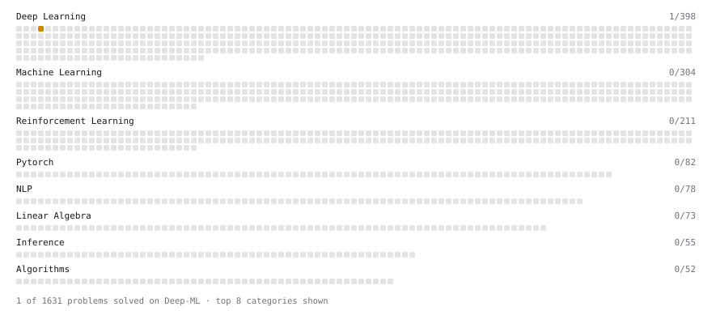

# Deep-ML

My machine learning practice from [Deep-ML](https://www.deep-ml.com). Every solution here was written by hand.

**5** solved · 5 problems · 0 labs · 0 math

[**Browse the interactive portfolio**](https://TrDuy-pan3000.github.io/deep-ml/) to replay this filling in over time.

## Problems

| | Difficulty | Solved | |
| --- | --- | --- | --- |
| [Implement Global Average Pooling](https://www.deep-ml.com/problems/114) | easy | 2026-10-24 | [solution](problems/0114-implement-global-average-pooling) |
| [Softmax Activation Function Implementation ](https://www.deep-ml.com/problems/23) | easy | 2026-10-24 | [solution](problems/0023-softmax-activation-function-implementation) |
| [Implement Batch Normalization for BCHW Input](https://www.deep-ml.com/problems/115) | medium | 2026-10-23 | [solution](problems/0115-implement-batch-normalization-for-bchw-input) |
| [Implementing a Simple RNN](https://www.deep-ml.com/problems/54) | medium | 2026-10-23 | [solution](problems/0054-implementing-a-simple-rnn) |
| [Single Neuron with Backpropagation](https://www.deep-ml.com/problems/25) | medium | 2026-10-23 | [solution](problems/0025-single-neuron-with-backpropagation) |

---

_This file is regenerated by Deep-ML on every push._
